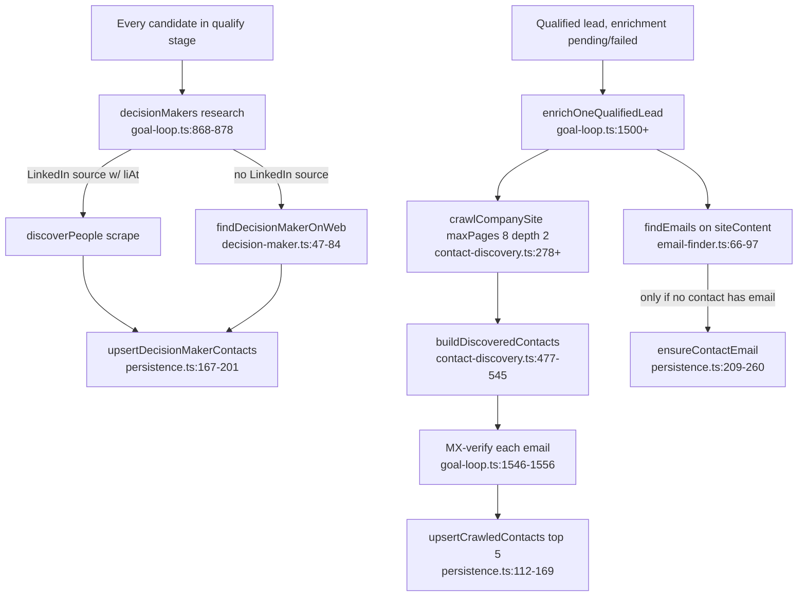

# Contact Gathering — Technical Reference

Purpose: a complete, file-anchored map of how Prospectus discovers, validates, and
persists contacts, written so an AI agent can discuss the workflow and propose
improvements without re-reading the whole harness. Everything cited is current
code as of 2026-10-27. Verification gate for any change:
`bunx tsc --noEmit 2>&1 | grep -v TS2307 | grep error` (TS2307 from
`@mastra/core/llm/model/shared.types` is pre-existing noise).

## 1. Scope & current yield

Contact gathering = everything that turns a qualified company into rows in the
`contacts` table (`src/db/schema.ts:216-236`). It does **not** include lead
discovery (see `docs/` history or the goal-loop reference for that).

Live numbers (campaign `b28eaca4-1a36-45ec-846d-f651e95478b1`, 2026-10-27):

| Metric | Value |
|---|---|
| Qualified + synced leads | 127 |
| Contacts persisted | 32 |
| Contacts with email | 29 |
| Contacts with phone | 3 |
| Contacts with WhatsApp | 1 |
| Contacts with LinkedIn URL | 1 |

Read: email harvesting works, people-level identity (LinkedIn) and phone/WA
harvesting barely fire. That asymmetry is the main design discussion.

## 2. The three contact pipelines

### 2.1 Decision-makers (all candidates, qualify stage)

- Entry: `goal-loop.ts:1153-1176` calls `research.decisionMakers`
  (`goal-loop.ts:868-878`).
- LinkedIn path: only if a `source:linkedin` credential with `liAt` cookie
  exists — uses `discoverPeople` from `src/plugins/builtin/linkedin`.
- Web fallback: `src/harness/decision-maker.ts:47-84`,
  `findDecisionMakerOnWeb` — one query
  `"{company}" (founder|owner|pemilik|direktur)` plus a `site:linkedin.com/in`
  variant, regex name/role extraction. **Returns max 1 person per company.**
- Persist: `upsertDecisionMakerContacts` (`persistence.ts:167-201`) — name /
  title / linkedinUrl, `isDecisionMaker: true`, ≤3 people. Runs for every
  candidate with DMs, qualified or not.

### 2.2 Site crawl + people extraction (qualified leads only)

- Trigger: `enrichQualifiedLeads` (`goal-loop.ts:1500+`), batch limit 20,
  selects leads with `enrichmentStatus in (pending, failed)`.
- Crawler: `crawlCompanySite` (`contact-discovery.ts:278+`) —
  maxPages 8 / maxDepth 2 from the goal loop, 10s per page, contact-priority
  path regex (`about|team|contact|impressum…`, `contact-discovery.ts:21`),
  6 priority + 4 deferred links per page. No robots.txt, no inter-page delay.
- Anti-bot chain per page: plain fetch (Chrome 156 UA) → Scrapling
  `solveCloudflare` via MCP (:9701, `src/harness/scrapling.ts`) → Patchright
  worker (`contact-discovery.ts:196-215`). 404 etc. → page skipped silently.
- Extraction (`buildDiscoveredContacts`, `contact-discovery.ts:477-545`):
  - People: regex name+title matching over block-split HTML
    (`contact-discovery.ts:152-200`), ≤15/page, keyword blacklist for
    false positives.
  - Emails: mailto + Cloudflare `data-cfemail` decode (:71-79) +
    obfuscation forms `[at]`/`[dot]` + junk filters. Per-person email match:
    `inferEmailPattern` + `guessPersonalEmails`; `observed` beats `inferred`.
  - Phones: Indonesian mobile regex + `tel:` + wa.me links, ≤10.
  - WhatsApp: `crawl.whatsapp` (wa.me link) attached to every contact row.
  - Socials: linkedin/instagram/x/facebook caps 5/3/3/3.
- **Verification (added 2026-10-27)**: before persist, each contact's email
  goes through `verifyEmail(email, { smtp: false, timeoutMs: 4000 })`
  (`goal-loop.ts:1546-1556`) — disposable-domain + MX check only. Invalid →
  email nulled, `emailPatternMethod = "rejected:<stage>"`. Full SMTP probe
  exists (`contact-discovery.ts:326-430`) but stays off in-loop (15s/email
  would stall enrichment of 20 leads).
- Persist: top 5 contacts via `upsertCrawledContacts`
  (`persistence.ts:112-169`) — writes `email`, `emailType`
  (`verified-personal` / `role` / `personal`), `phone`, **`whatsapp`**,
  `linkedinUrl`, `isDecisionMaker` (title regex), provenance jsonb.
  Upsert is `coalesce(existing, excluded)` — existing values never
  overwritten. WhatsApp-only contacts get identity key `wa:<number>`.
  **Postgres gotcha**: multi-word columns in `onConflictDoUpdate` templates
  must be `excluded."email_type"` — drizzle renders `excluded.emailType`
  unquoted and Postgres folds it to `emailtype` (does not exist).

### 2.3 Email-only fallback (qualified leads only)

- `findEmails` (`email-finder.ts:66-97`) runs over the qualification
  siteContent (homepage + ≤7 guessed paths, 60KB cap, ETag/304 cache) — only
  fires if NO contact row for the company has an email
  (`goal-loop.ts:1272-1276`).
- Pattern inference `patternCandidatesFor` (`email-finder.ts:50-63`): ≤4
  candidates, MX-checked before trust. Personal > role, first wins.
- Persist: `ensureContactEmail` (`persistence.ts:209-260`) — one email per
  company, attaches to an existing email-less contact when possible.

## 3. What each stage writes

| Writer | Table columns | When |
|---|---|---|
| `upsertDecisionMakerContacts` | name, title, linkedinUrl, isDecisionMaker | every candidate w/ DMs |
| `upsertCrawledContacts` | name, title, email, emailType, phone, whatsapp, linkedinUrl, isDecisionMaker, raw, fieldProvenance | qualified, enrichment pass |
| `ensureContactEmail` | email (on existing contact or new) | qualified, no email yet |
| `upsertContacts` | candidate.contacts from LLM extraction | persistCandidates time |
| `recordVerdict` | leads.contactTier (verdict only) | qualification |

Discarded today: socials beyond first LinkedIn, phones beyond first,
people beyond top 5, `emailConfidence` granularity beyond the 3-way
`emailType` (confidence details only survive in `raw`/provenance jsonb).

## 4. Known weaknesses (discussion targets, ranked)

1. **People extraction is regex-on-HTML.** Name+title detection
   (`contact-discovery.ts:152-200`) misses names in modern layouts (JS
   rendered, JSON-LD, schema.org `Person` markup is not parsed). Likely the
   biggest single yield lever: 127 qualified companies → 32 contacts means
   most crawls find emails but no people, or nothing.
2. **Decision-maker web fallback returns 1 person** (`decision-maker.ts:47-84`)
   and depends on zero keyed search providers — SearxNG/DDG snippets are thin
   for `site:linkedin.com/in` matching. A Serper/Brave key (Settings → Web
   search) directly multiplies DM yield.
3. **LinkedIn person scraping is all-or-nothing**: only runs when a
   `source:linkedin` credential with a live `liAt` cookie exists. There is no
   public-profile fallback tier.
4. **Crawl never runs pre-verdict.** Unresolved leads (98 right now) get no
   contact harvest; if they later qualify, enrichment pays a fresh crawl. A
   cheap contact harvest at screening time (emails only, no browser tier)
   would front-load value but costs crawl budget on leads that never qualify.
5. **Empty crawls are now retried but undiagnosed.** `crawledNothing` →
   `enrichmentStatus: "partial"` (`goal-loop.ts:1615-1619`) requeues forever
   with no counter; a lead whose site is genuinely dead should exhaust after
   N attempts, not loop.
6. **SMTP verification unused.** MX-only validation is in the loop
   (§2.2); the full SMTP probe with catch-all detection
   (`contact-discovery.ts:329-430`) exists but is never called — bounced
   emails are only caught by sink-side reality.
7. **Phone/WA extraction is Indonesian-mobile shaped** and capped; `tel:`
   landlines parsed but rarely title-attributed (first phone goes to every
   person row).
8. **No JSON-LD / structured-data contact harvest.** `SameAs`, `founder`,
   `employee`, `telephone` in schema.org blocks would be higher-precision than
   regex and trivially parseable.
9. **emailConfidence collapse**: crawl-time `observed|inferred|verified`
   becomes a coarse 3-way `emailType` at persist; the sink cannot distinguish
   "observed on contact page" from "observed in footer".

## 5. Improvement candidates (spec-shaped, for discussion)

### 5.1 JSON-LD + structured-data harvest (high yield / low cost)
In `crawlCompanySite` page processing, parse `<script type="application/ld+json">`
blocks before regex: `Person` nodes (name, jobTitle, email, telephone, sameAs),
`Organization` (founder, employee, telephone, contactPoint). Feed results into
`crawl.people` / `crawl.emails` with `emailsBySource` = page URL as usual.
Zero new network cost, strictly higher precision than regex.

### 5.2 People-page targeting (medium)
Current priority regex already likes `/team`, `/about`. Add `/ leadership |
management | org-structure | struktur-organisasi | direksi | kontak` (Indonesian
variants) and prefer those pages when the per-page budget (8) forces a choice.
`DEEP_SITE_PATHS` (`goal-loop.ts:589`) could gain the same tokens for the
qualification harvest.

### 5.3 Multi-person decision-maker search (medium, needs search key)
`findDecisionMakerOnWeb` currently one query → one person. With a keyed
provider: 3 queries (founder/owner, director/direktur, HRD/HR-manager), take
top 2 per role, cap 4-5 people. Persist via existing
`upsertDecisionMakerContacts` (already ≤3).

### 5.4 Bounded SMTP verification tier (low-medium)
Run full `verifyEmail` (SMTP on) only for `personal` emails on decision-makers
of leads that reached sink sync — small N, high value, off the hot loop.
Catch-all detection prevents false "invalid" on paranoid receivers.

### 5.5 Contact harvest for unresolved leads (design tradeoff, discuss first)
Option A: emails-only harvest (no browser tier, ≤2 pages) at screening time.
Option B: keep as-is. A is more cost on never-qualifying leads; its payoff
depends on how often unresolved leads eventually qualify (currently 98 sit in
that state).

### 5.6 Crawl-death counter (small)
Add a `fieldProvenance`-side attempt counter (or reuse `enrichmentStatus`
history) so `partial` leads stop retrying after 3 empty crawls; emit a
progress event with the reason (403-dominant vs DNS-dead) to guide proxy
decisions.

## 6. Guardrails for agents editing contact code

- Scraping stays out-of-process: plain fetch / Scrapling MCP / Patchright
  worker only. Never Playwright in-process under Bun.
- `upsertCrawledContacts` must remain `coalesce(existing, excluded)` — never
  overwrite a contact field with nulls on re-crawl.
- No comments, no `any`; nullable means "not observed" — no placeholders.
- MX-verify before persist stays: a rejected email must not silently persist.
- Sink adapters must keep distinguishing `emailType`; do not regress to
  "email is email".
- Verify behaviorally: run a manual campaign turn, check `contacts` rows
  gained `whatsapp`/`emailType`, and read `fieldProvenance` for the crawl
  stage. Type gate alone is not proof.
