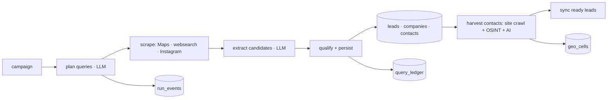

# Prospectus — system handover: schema, data semantics, measured behaviour

For an agent that will read this database. Everything below is verified against the live
system on 2026-10-31 unless marked `[INFERENCE]`. Connection:

```
docker exec prospectus-postgres psql -U prospectus -d prospectus
# postgres://prospectus:<POSTGRES_PASSWORD>@localhost:5432/prospectus
```

---

## 1. What the system does

Lead-generation platform. A *campaign* (niche + area) is run by a goal loop that plans
search queries with an LLM, scrapes Google Maps / web search / Instagram, extracts
company candidates, qualifies them, harvests contacts, and syncs ready leads to a sink.

Stack: Bun · Nuxt 4 (Nitro server routes) · Mastra agents · Drizzle ORM · Postgres
(pgvector image) · self-hosted 9Router LLM gateway (`lavender`/`limo` provider ids).
Containers: `prospectus-postgres`, `prospectus-searxng` (8888), `prospectus-scrapling`
(9701), `prospectus-warp` (SOCKS 1080), `prospectus-run-reaper`, `prospectus-openobserve`.



---

## 2. Tables

### campaigns — the work unit
| column | type | notes |
|---|---|---|
| `id` | uuid | PK |
| `user_id` | uuid | owner |
| `name`, `niche`, `area`, `notes` | text | `area` is free text ("Surabaya", "Jakarta", "Germany") — no fixed list |
| `brief_language` | text | `id` / `en` |
| `exclusions` | jsonb | business types never to target (e.g. `["warkop"]`) |
| `status` | text | `active` \| ... |
| `daily_lead_goal` | int | the lead target per run (500 = five hundred *prospect rows*) |
| `max_turns_per_run` | int, nullable | **NULL = unbounded turns** (stops on goal / wall clock / idle) |
| `max_cost_per_run_usd` | double, nullable | NULL = no cost cap |
| `schedule_enabled`, `schedule_interval_hours` | bool, int | scheduler picks these up |

### companies — one row per real-world business (global, not per campaign)
Key columns: `dedupe_key` (unique; derived from website domain, else phone, else address,
else normalized name), `name`, `website`, `address`, `city`, `province`, `country`,
`latitude`, `longitude`, `phone`, `industry_category`, `products_services` (jsonb),
`brief` + `brief_status`, `rating`, `review_count`, `digital_presence` (jsonb),
`raw` (jsonb — holds `{ mapsPlaceUrl }` for Maps-sourced rows), `field_provenance` (jsonb),
`created_by_run_id`.

**Dedupe is at the company level and is database-enforced** (`companies.dedupe_key` unique).
A business re-found by any query in any run does NOT create a second company; the existing
row is reused and, if coordinates were missing, backfilled.

`latitude`/`longitude` are parsed from the Google Maps place URL (`!3d<lat>!4d<lng>`).
Rows created before 2026-10-31 may have coordinates NULL even when `raw.mapsPlaceUrl` is
set — backfill with the regex in §7.

### leads — company × campaign (the "prospect row")
| column | notes |
|---|---|
| `company_id`, `campaign_id` | unique together (`leads_campaign_company_idx`) — one lead per company per campaign |
| `status` | `new` → `ready` → `synced` |
| `enrichment_status` | `pending` \| `partial` \| `complete` \| `failed` |
| `enrichment_attempts` | incremented on every enrich attempt; capped at 3 in the target selector |
| `contact_id` | optional pointer to a primary contact |
| `sheet_synced_at`, `created_by_run_id`, `created_at`, `updated_at` | |

**`status='ready'` is the deliverable.** "500 leads" = 500 leads with `status='ready'`.

### contacts — people / contact points at a company
`company_id`, `dedupe_key` (unique), `name`, `title`, `email`, `email_type`
(`role` \| `personal` \| `verified-personal`), `email_verification`, `phone`,
`phone_normalized`, `whatsapp`, `wa_likely`, `linkedin_url`, `is_decision_maker`, `raw`,
`field_provenance`. Conflict upsert uses `coalesce(existing, new)` — a re-crawl never
overwrites good data with worse.

### runs — one execution
`status` (`running` \| `succeeded` \| `failed` \| `cancelled`), `trigger`
(`manual` \| `schedule` \| `chat`), `turns`, `cost_usd`, `resume_state` (jsonb, for paused
runs), `error`, `started_at`, **`heartbeat_at`** (updated every 60s while alive),
`finished_at`.

**A `running` row with a stale `heartbeat_at` is a corpse, not work in progress.** The
out-of-process `prospectus-run-reaper` container fails any run whose heartbeat is older
than 15 minutes. Filter live runs as
`status='running' AND heartbeat_at > now() - interval '2 minutes'`.

### run_events — append-only progress log (the best observability source)
`run_id`, `campaign_id`, `stage`, `message`, `detail` (jsonb), `duration_ms`, `created_at`.
Stage values and what they mean:

| stage | meaning |
|---|---|
| `plan` | planner returned N queries; also carries ledger preload notices |
| `turn` | turn boundary, e.g. `turn 3/null · +12/500 prospect rows this run` |
| `scrape` | per-source artifact counts, cell sweeps (`cell qw8nt: 7 of 20 artifacts inside cell`) |
| `extract` | `N candidates extracted from M artifacts in K chunk(s) (Ns)` |
| `error` | chunk failures, source failures, abandoned spans |
| `harvest` | contact harvest pass, briefs, `+N prospect rows ready` |
| `persist` | company/contact writes, enrichment spans, OSINT rescues |
| `sync` | sink export |
| `done` | run finished with final status |

Note `duration_ms` is populated on only some events; for extraction timing parse the
`(Ns)` suffix inside the `extract` message.

### query_ledger — every query ever run, with yield
`campaign_id`, `query`, `query_norm` (normalized: lowercase, punctuation stripped),
`backend`, `result_count`, `leads_produced`, `run_id`, `created_at`.

Used for three things: the planner is shown productive + dead queries; at run start ALL
`query_norm` values for the campaign are preloaded so the planner cannot re-run a query
verbatim; and `result_count`/`leads_produced` drive the "0 leads in N prior runs → skip"
rule.

### geo_cells — spatial sweep state (one row per niche × geohash cell)
`campaign_id`, `niche_norm`, `cell_hash` (geohash), `center_lat`, `center_lng`,
`sweep_count`, `companies_found`, `consecutive_empty`, `cap_hit`, `done_at`,
`last_swept_at`. Unique on `(campaign_id, niche_norm, cell_hash)`.

Semantics: a Maps search is scoped to a cell viewport (`@lat,lng,14z`). A cell is `done`
after 2 consecutive sweeps with nothing inside it; a `cap_hit` cell gets subdivided one
geohash precision deeper. The region itself is **derived, never hardcoded**: bbox over the
campaign's own company coordinates, falling back to free OpenStreetMap geocoding of the
`area` string (cached in `app_settings` as `geocode:<area>`).

### sources / credentials / lead_sources
`sources` = per-query scrape targets, `adapter_type` ∈ `source:google-maps` |
`source:websearch` | `source:instagram` (others exist in code: linkedin, x, threads,
job-boards, news, csv, google-sheets). `credentials` = encrypted adapter credentials
(**currently 0 rows** — every scrape runs unauthenticated). `lead_sources` = lead ↔ source
provenance join.

### models / app_settings
`models` = catalog synced from the router's `/v1/models` (303 rows). `pricing` is empty for
every model on this router, so cost accounting uses a flat fallback of $0.15/M in,
$0.60/M out — **do not trust `runs.cost_usd` as model-accurate**.

`app_settings` keys in use: `model-selection` (per-stage model ids for `planner`,
`extractor`, `brief`, `chat`), and `geocode:<area>` cached bounding boxes.
Current selection: all four stages = `limo/deepseek-v4.1-flash`.

---

## 3. Field semantics — the no-guessing rule

Every stored attribute is either **sourced** (with provenance) or an explicit
**estimate** (method + confidence). NULL means "not observed" — never a placeholder.
Never write `""`, `0`, or `"N/A"` to mean unknown.

`field_provenance` (jsonb, on companies/contacts) accumulates per-field records, e.g.

```json
{ "email": { "stage": "pattern-inferred", "pattern": "first.last", "confidence": 0.6,
             "verifiedBy": "smtp", "verificationStatus": "valid", "at": "..." } }
{ "email": { "stage": "web-evidence", "sourceUrl": "...", "mentionsPerson": true, "at": "..." } }
{ "contact": { "stage": "site-crawl", "runId": "...", "at": "..." } }
```

Email acquisition stages, in the order the pipeline tries them: site crawl (AI-extracted
from page text, verbatim-grounded) → OSINT search harvest (incl. directory pages) →
pattern inference + MX check → verification. `email_confidence`-style signal lives on the
lead/contact path as `emailType` plus the provenance `stage`.

---

## 4. Measured behaviour (2026-10-31, Surabaya dental + Jakarta manufacturing)

| Metric | Measured |
|---|---|
| Google Maps query | 12-15 s, 20-40 artifacts per query (per-query budget now 120) |
| Jakarta manufacturing density | `pabrik manufaktur Jakarta Timur` → 20 · `Jakarta Barat` → 20 · `kawasan industri Jakarta Utara` → 34 (real `PT …` names) |
| Maps coordinate coverage | 20/20 artifacts carry parseable `!3d/!4d` coordinates |
| Extraction | 10-20 s per artifact; **40-80% of chunks failed on gateway 502s** before the fallback fix |
| Candidate yield | ~0.4 candidates per artifact when extraction succeeds |
| Ready conversion | **43%** of companies become `ready` |
| Web search | 5 results in ~0.9 s (searxng); DuckDuckGo is last-resort and rate-limits hard — `site:` + quoted-phrase queries fail outright |
| Instagram source | returns 0 artifacts every run (no credentials configured) |
| Enrich cost | serial 9 leads ≈ 40 min; now 6-wide concurrent with a 10-min per-span hard cap |
| Notable failure mode | the Nitro worker died of heap exhaustion after a 2.5 h hung span; fixed by per-span timeout + bounded scrapling reads + 2 GB heap ceiling |

Current database state: 3 campaigns · 54 companies · 57 leads (26 ready, 24 new, 7 synced)
· 89 contacts (9 with email, 37 with phone/WhatsApp, 0 with LinkedIn) · 9 runs ·
292 run_events · 54 sources · 0 credentials.

---

## 5. Query cookbook

Ready leads for a campaign, with contact coverage:
```sql
select l.id, c.name, c.city, c.website,
       (select count(*) from contacts k where k.company_id = c.id) as contacts,
       (select count(*) from contacts k where k.company_id = c.id and k.email is not null) as emails
from leads l join companies c on c.id = l.company_id
where l.campaign_id = '<uuid>' and l.status = 'ready'
order by l.updated_at desc;
```

Live (not zombie) runs:
```sql
select id, status, trigger, turns, heartbeat_at, started_at
from runs where status = 'running' and heartbeat_at > now() - interval '2 minutes';
```

Leads awaiting enrichment (the email work queue — matches the selector the pipeline uses):
```sql
select l.id, c.name, l.enrichment_status, l.enrichment_attempts
from leads l join companies c on c.id = l.company_id
where l.campaign_id = '<uuid>' and l.status in ('new','ready')
  and l.enrichment_status in ('pending','failed','partial') and l.enrichment_attempts < 3
  and not exists (select 1 from contacts k where k.company_id = l.company_id and k.email is not null);
```

What the run actually did, in order:
```sql
select to_char(created_at,'HH24:MI:SS') t, stage, left(message,110)
from run_events where campaign_id = '<uuid>' order by created_at desc limit 50;
```

Per-stage wall-clock share (parse the message for extraction):
```sql
select stage, count(*), min(created_at), max(created_at)
from run_events where campaign_id = '<uuid>' group by stage order by min(created_at);
```

Company yield per query, so you can see which queries actually pay:
```sql
select query, result_count, leads_produced, backend, created_at
from query_ledger where campaign_id = '<uuid>' order by created_at desc;
```

Cell sweep coverage:
```sql
select cell_hash, sweep_count, companies_found, consecutive_empty, cap_hit, done_at
from geo_cells where campaign_id = '<uuid>' order by created_at;
```

Coordinate backfill for legacy rows:
```sql
update companies
set latitude  = (substring(raw->>'mapsPlaceUrl' from '!3d(-?[0-9]+\.[0-9]+)'))::double precision,
    longitude = (substring(raw->>'mapsPlaceUrl' from '!4d(-?[0-9]+\.[0-9]+)'))::double precision
where raw->>'mapsPlaceUrl' like '%!3d%' and (latitude is null or longitude is null);
```

---

## 6. Gotchas

1. **`status='running'` is not proof of work** — check `heartbeat_at` (§2 runs).
2. **`runs.cost_usd` is unreliable** — the router exposes no pricing; a flat fallback rate
   is applied.
3. **`contacts.email` is scarce by design of the market, not the code.** Indonesian SME
   sites publish phone/WhatsApp far more than email. Measured: 9 of 89 contacts have an
   email. Phone/WA coverage is the realistic floor; Instagram bios (needs a credential in
   Settings) are the largest untapped email source.
4. **Instagram and LinkedIn adapters return nothing** while `credentials` is empty.
5. **Dedupe means counts do not sum across runs.** 54 companies and 57 leads came from 9
   runs; a re-discovered business adds 0 new companies.
6. **Query repeats are blocked verbatim, not semantically.** `pabrik gigi surabaya` and
   `klinik gigi surabaya` are different norms; dedupe at the company level catches the
   overlap.
7. **Geocoding is keyless (OpenStreetMap Nominatim) and cached** — be polite, do not
   bulk-geocode; the cache lives in `app_settings`.
8. **`geo_cells` is per niche**: `niche_norm` is `"<niche> <area>"` lowercased and stripped
   of punctuation. Changing a campaign's niche starts a fresh sweep map.

---

## 7. Operations

- Dev server: `bun run dev` (port 3000; `NODE_OPTIONS=--max-old-space-size=2048` is wired
  into the script as a heap ceiling).
- Type check gate: `bunx tsc --noEmit 2>&1 | grep -v TS2307 | grep error` → no output is
  clean (`TS2307` on `@mastra/core/llm/model/shared.types` is a known pre-existing warning).
- Migrations: `bun run db:generate` then `bun run db:migrate` (Drizzle, `drizzle/*.sql`).
- Target metric for scaling: at 43% ready conversion, 500 ready leads ≈ 1,175 companies
  ≈ 5,000-9,000 artifacts. With parallel extraction (4-wide, 5-artifact chunks), a
  fallback model, 6-wide enrichment and 120-artifact Maps pages, that is roughly
  10-14 hours of run time; before those fixes it was 45-60 hours.
